# GRASP Class Diagram — Before / After Phase 2

## Before (start of Phase 2)

All classes involved in the 34 violations of the consolidated audit
(`docs/grasp-audit/consolidated-audit.md`), across all three members'
scopes, with the violation IDs that touch each one.

```mermaid
classDiagram
    %% ===== Sales & UI (Technical Leader) =====
    class Sale {
        -products: List~Product~
        -total: double
        -discountAmount: double
        -additionalCost: double
        +addProduct(Product)
        +canBeReturned() bool
        +getFinalTotal() double
        +generateReceipt() String
        +getDiscountRate() double
    }
    note for Sale "V-01: generateReceipt() builds presentation text\nV-09 (needs): getDiscountRate() for Return to reuse"

    class SaleDAO {
        -personDAO: PersonDAO
        -productDAO: ProductDAO
        +save(Sale)
        +findAll() List~Sale~
        +findByCustomer(String) List~Sale~
        +findBySeller(String) List~Sale~
        -fromLine(String) Sale
    }
    note for SaleDAO "V-02: findByCustomer/findBySeller leak IOException\nV-34: depends on ProductDAO directly"

    class SaleService {
        -saleDAO: SaleDAO
        -productDAO: ProductDAO
        -accessoryDAO: AccessoryDAO
        -promotionService: PromotionService
        -warrantyService: WarrantyService
        -personService: PersonService
        +registerSale(...) Sale
    }
    note for SaleService "V-03: registerSale does 9 steps\nV-04: instanceof Console\nV-34: depends on ProductDAO directly"

    class MainMenu {
        -personService: PersonService
        -productService: ProductService
        -saleService: SaleService
        -accessoryService: AccessoryService
        -promotionService: PromotionService
        -warrantyService: WarrantyService
        -returnService: ReturnService
        +registerVideoGame()
        +registerConsole()
        +registerSale()
    }
    note for MainMenu "V-05: creates VideoGame/Console directly\nV-06: 7 feature areas in one class\nV-07: instanceof Console"

    %% ===== Products (Developer 1) =====
    class Product {
        -stock: int
        +reduceStock(int)
        +hasEnoughStock(int) bool
        +requiresWarranty() bool
    }
    note for Product "V-08 (needs): hasEnoughStock() as single source\nFF-01 (needs): requiresWarranty()"

    class VideoGame
    class Console
    VideoGame --|> Product
    Console --|> Product

    class ProductDAO {
        +writeAll(List~Product~)
        +parseLine(String) Product
        +findAll() List~Product~
    }
    note for ProductDAO "V-11: println + catch(Exception) in findAll\nV-12: instanceof VideoGame/Console"

    class ProductService {
        -productDAO: ProductDAO
        +checkStock(String, int) bool
        +restoreStock(String, int)
        +registerVideoGame(...)
        +registerConsole(...)
    }
    note for ProductService "V-08: duplicates stock-check rule\nV-10: depends on concrete ProductDAO\nFF-02 (needs): factory-style registration methods"

    class ProductValidator {
        +validateStockAvailability(Product, int)
    }
    note for ProductValidator "V-08: duplicates stock-check rule"

    %% ===== Accessories (Developer 1 model / Developer 2 service+DAO) =====
    class Accessory {
        -compatibleConsoleIds: List~String~
        +getCompatibleConsoleIds() List~String~
        +toCsvLine() String
        +getTypeCode() String
    }
    Accessory --|> Product
    note for Accessory "V-14: exposes mutable internal list\nFF-05 (needs): toCsvLine()/getTypeCode()"

    class Controller
    class Cable
    class Memory
    Controller --|> Accessory
    Cable --|> Accessory
    Memory --|> Accessory

    class AccessoryDAO {
        +writeAll(List~Accessory~)
        +findAll()
    }
    note for AccessoryDAO "V-17: instanceof Controller/Cable/Memory\nV-18: swallows IOException"

    class AccessoryService {
        -validateAccessory(Accessory)
        +matchesType(Accessory, String) bool
    }
    note for AccessoryService "V-19: instanceof-based matchesType\nV-20: validation as private method\nV-21: raw IllegalArgumentException"

    %% ===== Promotions (Developer 1 model / Developer 2 service+DAO) =====
    class Promotion {
        +toCsvLine() String
    }
    class PercentageDiscount
    class CategoryDiscount {
        +matchesCategory(Product) bool
    }
    class BulkPurchaseDiscount
    PercentageDiscount --|> Promotion
    CategoryDiscount --|> Promotion
    BulkPurchaseDiscount --|> Promotion
    note for CategoryDiscount "V-13: instanceof-based category match\nFF-06 (needs): toCsvLine()/category enum"

    class PromotionDAO {
        +saveAll(List~Promotion~)
    }
    note for PromotionDAO "V-22: instanceof branching for serialization\nV-23: swallows IOException"

    class PromotionService {
        -validatePercentage(double)
        -validateTargetCategory(String)
    }
    note for PromotionService "V-24: validation as private methods\nV-25: raw IllegalArgumentException"

    %% ===== Returns (Developer 1 model / Developer 2 service+repository) =====
    class Return {
        -returnedProducts: List~Product~
        +calculateRefundAmount() double
        +getReturnedProducts() List~Product~
    }
    note for Return "V-09: duplicates Sale's discount-rate formula\nV-14: exposes mutable internal list"

    class ReturnRepository {
        -saleService: SaleService
        -productService: ProductService
        -accessoryService: AccessoryService
        +fromLine(String) Return
    }
    note for ReturnRepository "V-26: persistence depends on 3 services (inverted layering)\nV-27: silently skips via println"

    class ReturnService {
        +registerReturn(...) Return
    }
    note for ReturnService "V-28: registerReturn does 9 steps\nV-29: instanceof Console/Accessory\nV-30: raw IllegalArgumentException"

    %% ===== Warranties (Developer 1 model / Developer 2 service+repository) =====
    class Warranty {
        +getWarrantyType() String
    }
    class BasicWarranty
    class ExtendedWarranty
    BasicWarranty --|> Warranty
    ExtendedWarranty --|> Warranty

    class WarrantyRepository {
        +toLine(Warranty) String
        +saveAll(List~Warranty~)
        +loadAll()
    }
    note for WarrantyRepository "V-31: instanceof ExtendedWarranty\nV-32: raw IOException propagated"

    class WarrantyService {
        +resolveWarranty(...)
    }
    note for WarrantyService "V-33: raw IllegalArgumentException + silent println"

    %% ===== People (Developer 2) =====
    class Person
    class Customer {
        -purchaseHistory: List~Sale~
        +getPurchaseHistory() List~Sale~
    }
    class Seller
    Customer --|> Person
    Seller --|> Person
    note for Customer "V-15: exposes mutable internal list"

    class PersonDAO
    note for PersonDAO "V-16: dead throws IOException declarations"

    %% ===== Relationships =====
    SaleService --> SaleDAO
    SaleService --> ProductDAO : V-34
    SaleService --> AccessoryDAO
    SaleService --> PromotionService
    SaleService --> WarrantyService
    SaleService --> PersonService
    SaleDAO --> ProductDAO
    SaleDAO --> PersonDAO
    MainMenu --> SaleService
    MainMenu --> ProductService
    MainMenu ..> VideoGame : creates (V-05)
    MainMenu ..> Console : creates (V-05)
    ProductService --> ProductDAO
    ProductService --> ProductValidator
    AccessoryService --> AccessoryDAO
    PromotionService --> PromotionDAO
    ReturnRepository --> SaleService : V-26
    ReturnRepository --> ProductService : V-26
    ReturnRepository --> AccessoryService : V-26
    ReturnService --> ReturnRepository
    ReturnService --> WarrantyService
    WarrantyService --> WarrantyRepository
    WarrantyService --> SaleDAO
    PersonService --> PersonDAO
    Sale "1" *-- "many" Product
    Return --> Sale
    Customer "1" *-- "many" Sale
```

## After (end of Phase 2)

Same classes as "Before", now reflecting every applied fix (all 34
violations of the consolidated audit resolved), plus the new classes
introduced by the corrections.

```mermaid
classDiagram
    %% ===== Sales & UI (Technical Leader) =====
    class Sale {
        -products: List~Product~
        -total: double
        -discountAmount: double
        -additionalCost: double
        +addProduct(Product)
        +canBeReturned() bool
        +getFinalTotal() double
        +generateReceipt() String
        +getDiscountRate() double
    }
    note for Sale "V-01 fixed: generateReceipt() delegates to SaleReceiptFormatter\nV-09 fixed: getDiscountRate() is the single source, reused by Return"

    class SaleReceiptFormatter {
        +format(Sale) String$
    }
    note for SaleReceiptFormatter "V-01: new Pure Fabrication holding all receipt presentation text"

    class SaleDAO {
        -personDAO: PersonDAO
        -productDAO: ProductDAO
        +save(Sale)
        +findAll() List~Sale~
        +findByCustomer(String) List~Sale~
        +findBySeller(String) List~Sale~
    }
    note for SaleDAO "V-02 fixed: findByCustomer/findBySeller wrap IOException as PersistenceException\nSaleDAO to ProductDAO kept: persistence-to-persistence, consistent with the layering rule"

    class SaleService {
        -saleDAO: SaleDAO
        -productService: ProductService
        -accessoryDAO: AccessoryDAO
        -promotionService: PromotionService
        -warrantyService: WarrantyService
        -personService: PersonService
        +registerSale(...) Sale
        -resolveCustomer(String) Customer
        -resolveSeller(String) Seller
        -resolveSaleItems(...)
        -buildSale(...) Sale
        -applyBestPromotion(Sale)
        -assignWarranties(...) double
        -updateInventory(...)
    }
    note for SaleService "V-03 fixed: registerSale split into 7 private helper methods\nV-04 fixed: uses product.requiresWarranty() instead of instanceof Console\nV-34 fixed: depends on ProductService, not ProductDAO"

    class MenuDialogs {
        +askInput(String) String$
        +showList(String, String)$
        +formatEntries(List~String~) String$
        +showResourceNotFound(...)$
        +showBusinessRuleViolation(...)$
        +showInvalidData(...)$
        +showPersistenceError()$
        +showGenericError(...)$
    }
    note for MenuDialogs "V-06: new Pure Fabrication for the dialog helpers shared by MainMenu and all 7 area menus"

    class MainMenu {
        -productMenuView: ProductMenu
        -personMenuView: PersonMenu
        -saleMenuView: SaleMenu
        -accessoryMenuView: AccessoryMenu
        -promotionMenuView: PromotionMenu
        -returnMenuView: ReturnMenu
        -warrantyMenuView: WarrantyMenu
        +start()
    }
    note for MainMenu "V-06 fixed: 1105 lines to 120 lines; only owns the main loop and top-level exception translation"

    class ProductMenu {
        -productService: ProductService
        +show()
    }
    note for ProductMenu "V-05 fixed: delegates to ProductService.registerVideoGame/registerConsole instead of 'new VideoGame/Console'\nV-06: extracted product-area UI"

    class PersonMenu {
        -personService: PersonService
        +show()
    }
    note for PersonMenu "V-06: extracted people-area UI"

    class SaleMenu {
        -saleService: SaleService
        -productService: ProductService
        +show()
    }
    note for SaleMenu "V-06: extracted sale-area UI\nV-07 fixed: uses product.requiresWarranty() instead of instanceof Console"

    class AccessoryMenu {
        -accessoryService: AccessoryService
        +show()
    }
    note for AccessoryMenu "V-06: extracted accessory-area UI"

    class PromotionMenu {
        -promotionService: PromotionService
        +show()
    }
    note for PromotionMenu "V-06: extracted promotion-area UI"

    class ReturnMenu {
        -returnService: ReturnService
        +show()
    }
    note for ReturnMenu "V-06: extracted return-area UI, includes consultMonthlyBalance"

    class WarrantyMenu {
        -warrantyService: WarrantyService
        +show()
    }
    note for WarrantyMenu "V-06: extracted warranty-area UI"

    %% ===== Products (Developer 1) =====
    class Product {
        -stock: int
        +reduceStock(int)
        +hasEnoughStock(int) bool
        +requiresWarranty() bool
    }

    class VideoGame
    class Console
    VideoGame --|> Product
    Console --|> Product

    class ProductRepository {
        <<interface>>
        +save(Product)
        +findAll() List~Product~
        +findById(String) Product
        +update(Product)
    }
    note for ProductRepository "V-10 fixed: new interface; ProductService depends on this abstraction, not the concrete ProductDAO"

    class ProductCsvMapper {
        <<interface>>
        +toCsvLine(Product) String
    }
    class VideoGameCsvMapper
    class ConsoleCsvMapper
    VideoGameCsvMapper ..|> ProductCsvMapper
    ConsoleCsvMapper ..|> ProductCsvMapper

    class ProductDAO {
        -mappers: List~ProductCsvMapper~
        +findAll() List~Product~
    }
    ProductDAO ..|> ProductRepository
    note for ProductDAO "V-11 fixed: wraps failures as PersistenceException, no println/catch(Exception)\nV-12 fixed: dispatches to the matching ProductCsvMapper instead of instanceof"

    class ProductService {
        -productDAO: ProductRepository
        +checkStock(String, int) bool
        +restoreStock(String, int)
        +reduceStock(String, int)
        +registerVideoGame(...)
        +registerConsole(...)
    }
    note for ProductService "V-08 fixed: stock check delegated to Product.hasEnoughStock()\nV-10 fixed: depends on ProductRepository interface\nFF-02 resolved: factory methods used by MainMenu/ProductMenu"

    class ProductValidator {
        +validateStockAvailability(Product, int)$
    }
    note for ProductValidator "V-08 fixed: calls Product.hasEnoughStock(), rule no longer duplicated"

    %% ===== Accessories =====
    class Accessory {
        -compatibleConsoleIds: List~String~
        +getCompatibleConsoleIds() List~String~
        +toCsvLine() String*
        +getTypeCode() String*
    }
    Accessory --|> Product
    note for Accessory "V-14 fixed: getCompatibleConsoleIds() returns an unmodifiable view\nFF-05 resolved: toCsvLine()/getTypeCode() implemented per subtype"

    class Controller
    class Cable
    class Memory
    Controller --|> Accessory
    Cable --|> Accessory
    Memory --|> Accessory

    class AccessoryDAO {
        +writeAll(List~Accessory~)
        +findAll()
    }
    note for AccessoryDAO "V-17 fixed: delegates to accessory.getTypeCode()/toCsvLine(), no instanceof\nV-18 fixed: wraps failures as PersistenceException"

    class AccessoryValidator {
        +validate(Accessory)$
    }
    note for AccessoryValidator "V-20/V-21 fixed: extracted out of AccessoryService, throws InvalidDataException"

    class AccessoryService {
        -accessoryDAO: AccessoryDAO
        +matchesType(Accessory, String) bool
    }
    note for AccessoryService "V-19 fixed: matchesType compares accessory.getTypeCode(), no instanceof"

    %% ===== Promotions =====
    class ProductCategory {
        <<enumeration>>
        VIDEOGAME
        CONSOLE
        ACCESSORY
    }
    note for ProductCategory "V-13 fixed: new enum replaces instanceof-based category matching"

    class Promotion {
        +toCsvLine() String*
    }
    class PercentageDiscount
    class CategoryDiscount {
        -targetCategory: ProductCategory
        +matchesCategory(Product) bool
    }
    class BulkPurchaseDiscount
    PercentageDiscount --|> Promotion
    CategoryDiscount --|> Promotion
    BulkPurchaseDiscount --|> Promotion
    CategoryDiscount --> ProductCategory
    note for CategoryDiscount "V-13 fixed: matchesCategory uses ProductCategory, no instanceof\nFF-06 resolved"

    class PromotionDAO {
        +saveAll(List~Promotion~)
    }
    note for PromotionDAO "V-22 fixed: delegates to promotion.toCsvLine(), no instanceof\nV-23 fixed: wraps failures as PersistenceException"

    class PromotionValidator {
        +validatePercentage(double)$
        +validateTargetCategory(String)$
    }
    note for PromotionValidator "V-24/V-25 fixed: extracted out of PromotionService, throws InvalidDataException"

    class PromotionService {
        -promotionDAO: PromotionDAO
    }

    %% ===== Returns =====
    class Return {
        -returnedProducts: List~Product~
        +calculateRefundAmount() double
        +getReturnedProducts() List~Product~
    }
    note for Return "V-09 fixed: calculateRefundAmount() reuses Sale.getDiscountRate()\nV-14 fixed: getReturnedProducts() returns an unmodifiable view"

    class ReturnRecord {
        -id: String
        -saleId: String
        -productIds: List~String~
        -reason: String
    }
    note for ReturnRecord "V-26 fixed: plain DTO read by ReturnRepository, replacing the 3-service dependency"

    class ReturnRepository {
        +save(Return)
        +findAll() List~ReturnRecord~
    }
    ReturnRepository --> ReturnRecord
    note for ReturnRepository "V-26 fixed: persistence layer no longer depends on SaleService/ProductService/AccessoryService\nV-27 fixed: wraps failures as PersistenceException, no silent println"

    class ReturnService {
        -returnRepository: ReturnRepository
        -saleService: SaleService
        -warrantyService: WarrantyService
        +registerReturn(...) Return
        -validateReturnRequest(...)
        -findReturnableSale(...) Sale
        -resolveReturnedProducts(...) List~Product~
        -cancelConsoleWarranties(...) double
        -restoreStockOf(...)
        -resolveReturn(ReturnRecord) Return
    }
    note for ReturnService "V-28 fixed: registerReturn split into private helper methods\nV-29 fixed: uses product.requiresWarranty() instead of instanceof\nV-30 fixed: throws typed GameZoneException subtypes"

    %% ===== Warranties =====
    class Warranty {
        +getWarrantyType() String*
    }
    class BasicWarranty
    class ExtendedWarranty
    BasicWarranty --|> Warranty
    ExtendedWarranty --|> Warranty

    class WarrantyRepository {
        +toLine(Warranty) String
        +saveAll(List~Warranty~)
        +loadAll()
    }
    note for WarrantyRepository "V-31 fixed: delegates to warranty.getWarrantyType(), no instanceof\nV-32 fixed: wraps failures as PersistenceException"

    class WarrantyService {
        -warrantyRepository: WarrantyRepository
        -saleDAO: SaleDAO
        +resolveWarranty(...)
    }
    note for WarrantyService "V-33 fixed: throws InvalidDataException, no silent println"

    %% ===== People =====
    class Person
    class Customer {
        -purchaseHistory: List~Sale~
        +getPurchaseHistory() List~Sale~
    }
    class Seller
    Customer --|> Person
    Seller --|> Person
    note for Customer "V-15 fixed: getPurchaseHistory() returns an unmodifiable view"

    class PersonDAO
    note for PersonDAO "V-16 fixed: dead 'throws IOException' declarations removed"

    %% ===== Relationships =====
    SaleService --> SaleDAO
    SaleService --> ProductService : V-34 fixed
    SaleService --> AccessoryDAO
    SaleService --> PromotionService
    SaleService --> WarrantyService
    SaleService --> PersonService
    SaleDAO --> ProductDAO
    SaleDAO --> PersonDAO
    Sale ..> SaleReceiptFormatter : V-01 fixed
    MainMenu --> ProductMenu
    MainMenu --> PersonMenu
    MainMenu --> SaleMenu
    MainMenu --> AccessoryMenu
    MainMenu --> PromotionMenu
    MainMenu --> ReturnMenu
    MainMenu --> WarrantyMenu
    MainMenu ..> MenuDialogs
    ProductMenu ..> MenuDialogs
    PersonMenu ..> MenuDialogs
    SaleMenu ..> MenuDialogs
    AccessoryMenu ..> MenuDialogs
    PromotionMenu ..> MenuDialogs
    ReturnMenu ..> MenuDialogs
    WarrantyMenu ..> MenuDialogs
    ProductMenu --> ProductService
    SaleMenu --> SaleService
    SaleMenu --> ProductService
    AccessoryMenu --> AccessoryService
    PromotionMenu --> PromotionService
    ReturnMenu --> ReturnService
    WarrantyMenu --> WarrantyService
    PersonMenu --> PersonService
    ProductService --> ProductRepository : V-10 fixed
    ProductService --> ProductValidator
    AccessoryService --> AccessoryDAO
    AccessoryService --> AccessoryValidator
    PromotionService --> PromotionDAO
    PromotionService --> PromotionValidator
    ReturnService --> ReturnRepository : V-26 fixed
    ReturnService --> WarrantyService
    WarrantyService --> WarrantyRepository
    WarrantyService --> SaleDAO
    PersonService --> PersonDAO
    Sale "1" *-- "many" Product
    Return --> Sale
    Customer "1" *-- "many" Sale
```

All 34 violations of the consolidated audit are reflected as fixed above.
See `docs/grasp-refactor-log.md` for the commit-by-commit detail of each
correction.