# SOLID Class Diagram — Before / After Phase 2

## Before (start of Phase 2)

All classes involved in the 26 violations of the consolidated audit
(`docs/solid-audit/consolidated-audit.md`), across the three members' scopes,
with the violation IDs that touch each one. The state is `develop` at
`cb242c5`.

The diagram shows the classes with a violation and the dependencies that
the corrections change; classes without findings (for example `MenuDialogs`
or the validators other than `PromotionValidator`) are omitted.

### Violation index

| ID | Class(es) in the diagram | Principle |
|---|---|---|
| V-01 | `Sale` | DIP |
| V-02 | `SaleDAO` | SRP |
| V-03 | `SaleDAO`, `SaleService` | DIP |
| V-04 | `SaleService` | OCP |
| V-05 | `SaleService` | DIP |
| V-06 | `MainMenu` | OCP |
| V-07 | `ProductDAO` | SRP |
| V-08 | `Accessory`, `Promotion`, `Warranty` | SRP |
| V-09 | `Return`, `Warranty`, `ReturnMenu`, `WarrantyMenu` | SRP |
| V-10 | `ProductService`, `ProductMenu` | OCP |
| V-11 | `ProductDAO` | OCP |
| V-12 | `Console` | LSP |
| V-13 | `ProductCsvMapper` | LSP |
| V-14 | `PromotionValidator` | OCP |
| V-15 | `PersonDAO` | SRP |
| V-16 | `ReturnService`, `ReturnMenu` | SRP |
| V-17 | `ReturnService` | SRP |
| V-18 | `WarrantyService` | SRP |
| V-19 | `AccessoryDAO` | OCP |
| V-20 | `PromotionDAO` | OCP |
| V-21 | `WarrantyService` | OCP |
| V-22 | `WarrantyService` | ISP |
| V-23 | `PersonService` | DIP |
| V-24 | `AccessoryService` | DIP |
| V-25 | `PromotionService` | DIP |
| V-26 | `ReturnService`, `WarrantyService`, `ReturnRepository`, `WarrantyRepository` | DIP |

## After (end of Phase 2)

The same classes after the corrections, with the new classes and the
relationships that replace the ones marked in the "Before" diagram. Every
violation ID appears where its fix is. The state is `develop` with all the
Phase 2 corrections (V-01 to V-26).

```mermaid
classDiagram
    class Sale {
        -products: List~Product~
        -total: double
        -discountAmount: double
        -additionalCost: double
        +getFinalTotal() double
        +getDiscountRate() double
    }
    note for Sale "V-01: no generateReceipt(), the model no longer knows ui"
    class SaleReceiptFormatter {
        +format(Sale) String
    }
    class SaleReader {
        <<interface>>
        +findAll() List~Sale~
    }
    class SaleRepository {
        <<interface>>
        +save(Sale)
        +findByCustomer(String) List~Sale~
        +findBySeller(String) List~Sale~
    }
    SaleRepository --|> SaleReader
    class SaleDAO {
        +save(Sale)
        +findAll() List~Sale~
    }
    SaleDAO ..|> SaleRepository
    class SaleCsvMapper {
        +toLine(Sale) String
        +fromLine(String) Sale
    }
    note for SaleDAO "V-02: only file access\nV-03: implements SaleRepository"
    note for SaleCsvMapper "V-02: owns the line format\nV-03: receives repositories, no concrete DAO"
    class SaleItemSource {
        <<interface>>
        +findItem(String) Product
        +validateStock(Product, int)
        +reduceStock(Product, int)
    }
    class ProductItemSource
    class AccessoryItemSource
    ProductItemSource ..|> SaleItemSource
    AccessoryItemSource ..|> SaleItemSource
    class SaleService {
        -saleRepository: SaleRepository
        -itemSources: List~SaleItemSource~
        +registerSale(...) Sale
    }
    note for SaleService "V-03: depends on SaleRepository\nV-04: one loop over item sources\nV-05: no AccessoryDAO, uses AccessoryService"
    class AreaMenu {
        <<interface>>
        +getTitle() String
        +show()
    }
    class MainMenu {
        -areaMenus: List~AreaMenu~
        +start()
    }
    note for MainMenu "V-06: receives the menus, knows none of them"
    class ProductMenu
    class PersonMenu
    class SaleMenu
    class AccessoryMenu
    class PromotionMenu
    class ReturnMenu
    class WarrantyMenu
    ProductMenu ..|> AreaMenu
    PersonMenu ..|> AreaMenu
    SaleMenu ..|> AreaMenu
    AccessoryMenu ..|> AreaMenu
    PromotionMenu ..|> AreaMenu
    ReturnMenu ..|> AreaMenu
    WarrantyMenu ..|> AreaMenu
    note for ProductMenu "V-10: calls registerNewProduct"
    note for ReturnMenu "V-09: uses ReturnReceiptFormatter\nV-16: uses MonthlyBalanceService"
    note for WarrantyMenu "V-09: uses WarrantyCertificateFormatter"
    class ReturnReceiptFormatter {
        +format(Return) String
    }
    class WarrantyCertificateFormatter {
        +format(Warranty) String
    }
    class Product {
        -stock: int
        +getCategory() ProductCategory
        +requiresWarranty() bool
    }
    class VideoGame
    class Console {
        +getCategory() ProductCategory
    }
    note for Console "V-12: getCategory() returns CONSOLE"
    VideoGame --|> Product
    Console --|> Product
    class ProductCsvMapper {
        <<interface>>
        +getCategory() ProductCategory
        +supports(Product) bool
        +toCsvLine(Product) String
        +parse(String[]) Product
    }
    class VideoGameCsvMapper
    class ConsoleCsvMapper
    VideoGameCsvMapper ..|> ProductCsvMapper
    ConsoleCsvMapper ..|> ProductCsvMapper
    note for ProductCsvMapper "V-13: supports() states the precondition\nV-07: parse() reads the whole line"
    class ProductRepository {
        <<interface>>
    }
    class ProductDAO {
        -mappers: List~ProductCsvMapper~
        -writeAll(List~Product~)
    }
    ProductDAO ..|> ProductRepository
    note for ProductDAO "V-07: only splits the line and delegates\nV-11: mappers received in the constructor"
    class ProductFactory {
        <<interface>>
        +getCategory() ProductCategory
        +create(...) Product
    }
    class VideoGameFactory
    class ConsoleFactory
    VideoGameFactory ..|> ProductFactory
    ConsoleFactory ..|> ProductFactory
    class ProductService {
        -productDAO: ProductRepository
        -factories: Map~ProductCategory, ProductFactory~
        +registerNewProduct(...)
        +reduceStock(String, int)
        +restoreStock(String, int)
    }
    note for ProductService "V-10: one factory per category, received in the constructor"
    class Accessory
    class Controller
    class Cable
    class Memory
    Accessory --|> Product
    Controller --|> Accessory
    Cable --|> Accessory
    Memory --|> Accessory
    class Promotion
    class PercentageDiscount
    class CategoryDiscount
    class BulkPurchaseDiscount
    PercentageDiscount --|> Promotion
    CategoryDiscount --|> Promotion
    BulkPurchaseDiscount --|> Promotion
    class Warranty
    class BasicWarranty
    class ExtendedWarranty
    BasicWarranty --|> Warranty
    ExtendedWarranty --|> Warranty
    note for Accessory "V-08: no CSV methods in the model"
    note for Promotion "V-08: no CSV methods in the model"
    note for Warranty "V-08: no type code\nV-09: no certificate text"
    class Return {
        +calculateRefundAmount() double
    }
    note for Return "V-09: no receipt text"
    class AccessoryCsvMapper {
        +toCsvLine(Accessory) String
        +parseLine(String) Accessory
    }
    class PromotionCsvMapper {
        +toCsvLine(Promotion) String
        +parseLine(String) Promotion
    }
    class WarrantyTypeMapper {
        +toTypeCode(Warranty) String
        +create(...) Warranty
    }
    note for AccessoryCsvMapper "V-08, V-19: owns the format, finds the parser by type code"
    note for PromotionCsvMapper "V-08, V-20: owns the format, finds the parser by type code"
    note for WarrantyTypeMapper "V-08, V-21: owns the type code in both directions"
    class AccessoryRepository {
        <<interface>>
    }
    class AccessoryDAO
    AccessoryDAO ..|> AccessoryRepository
    class AccessoryService {
        -accessoryDAO: AccessoryRepository
        +updateStock(String, int)
    }
    note for AccessoryService "V-24: depends on AccessoryRepository"
    class PromotionRepository {
        <<interface>>
    }
    class PromotionDAO
    PromotionDAO ..|> PromotionRepository
    class PromotionService {
        -promotionDAO: PromotionRepository
    }
    note for PromotionService "V-25: depends on PromotionRepository"
    class PromotionValidator {
        +validateTargetCategory(String)
    }
    note for PromotionValidator "V-14: validates with ProductCategory.fromText"
    class Person
    class Customer
    class Seller
    Customer --|> Person
    Seller --|> Person
    class CustomerRepository {
        <<interface>>
        +saveCustomers(List~Customer~)
        +loadCustomers() List~Customer~
    }
    class SellerRepository {
        <<interface>>
        +saveSellers(List~Seller~)
        +loadSellers() List~Seller~
    }
    class CustomerDAO
    class SellerDAO
    CustomerDAO ..|> CustomerRepository
    SellerDAO ..|> SellerRepository
    note for CustomerDAO "V-15: one DAO per concern"
    note for SellerDAO "V-15: one DAO per concern"
    class PersonService {
        -customerRepository: CustomerRepository
        -sellerRepository: SellerRepository
    }
    note for PersonService "V-23: receives both repositories"
    class ReturnRepository {
        <<interface>>
        +saveAll(List~Return~)
        +loadAll() List~ReturnRecord~
    }
    class CsvReturnRepository
    CsvReturnRepository ..|> ReturnRepository
    class ReturnRecordResolver {
        +loadAll() List~Return~
        -resolve(ReturnRecord) Return
    }
    note for ReturnRecordResolver "V-17: rebuilds Return from records"
    class ReturnService {
        +registerReturn(...) Return
        +viewAllReturns() List~Return~
    }
    note for ReturnService "V-16: no monthly balance\nV-17: delegates the rebuilding\nV-26: depends on ReturnRepository"
    class MonthlyBalanceService {
        +calculateMonthlySales(int, int) double
        +calculateMonthlyReturns(int, int) double
        +generateMonthlyBalance(int, int) double
    }
    note for MonthlyBalanceService "V-16: monthly balance extracted"
    class WarrantyRepository {
        <<interface>>
        +saveAll(List~Warranty~)
        +loadAll() List~WarrantyRecord~
    }
    class CsvWarrantyRepository
    CsvWarrantyRepository ..|> WarrantyRepository
    class WarrantyRecordResolver {
        -saleReader: SaleReader
        +loadAll() List~Warranty~
        -resolve(WarrantyRecord) Warranty
    }
    note for WarrantyRecordResolver "V-18: record mapping and sale lookup\nV-22: reads sales through SaleReader"
    class WarrantyService {
        -warrantyRepository: WarrantyRepository
        -recordResolver: WarrantyRecordResolver
    }
    note for WarrantyService "V-18: only the warranty rules\nV-26: depends on WarrantyRepository"
    SaleService --> SaleRepository : V-03
    SaleService --> SaleItemSource : V-04
    SaleService --> PromotionService
    SaleService --> WarrantyService
    SaleService --> PersonService
    ProductItemSource --> ProductService
    AccessoryItemSource --> AccessoryService : V-05
    SaleDAO --> SaleCsvMapper : V-02
    SaleCsvMapper --> CustomerRepository : V-03
    SaleCsvMapper --> SellerRepository : V-03
    SaleCsvMapper --> ProductRepository : V-03
    SaleMenu --> SaleService
    SaleMenu ..> SaleReceiptFormatter : V-01
    MainMenu --> AreaMenu : V-06
    ReturnMenu ..> ReturnReceiptFormatter : V-09
    ReturnMenu --> MonthlyBalanceService : V-16
    WarrantyMenu ..> WarrantyCertificateFormatter : V-09
    ProductService --> ProductRepository
    ProductService --> ProductFactory : V-10
    ProductDAO --> ProductCsvMapper : V-11
    AccessoryDAO --> AccessoryCsvMapper : V-19
    PromotionDAO --> PromotionCsvMapper : V-20
    AccessoryService --> AccessoryRepository : V-24
    PromotionService --> PromotionRepository : V-25
    PromotionService --> PromotionValidator
    PersonService --> CustomerRepository : V-23
    PersonService --> SellerRepository : V-23
    ReturnService --> ReturnRepository : V-26
    ReturnService --> ReturnRecordResolver : V-17
    ReturnRecordResolver --> ReturnRepository
    MonthlyBalanceService --> SaleService
    MonthlyBalanceService --> ReturnService
    WarrantyService --> WarrantyRepository : V-26
    WarrantyService --> WarrantyRecordResolver : V-18
    WarrantyRecordResolver --> SaleReader : V-22
    WarrantyRecordResolver --> WarrantyTypeMapper : V-21
    CsvWarrantyRepository --> WarrantyTypeMapper : V-21
    Sale "1" *-- "many" Product
    Return --> Sale
```

As in the "Before" diagram, classes without findings are omitted. The
dependencies now point from the `ui` and `service` layers to interfaces
(`SaleRepository`, `AreaMenu`, `SaleItemSource`, the repositories), and no
class of the `model` package depends on `ui` or `persistence`.

### Resolution index

| ID | Fix applied | Class(es) in the diagram | Principle |
|---|---|---|---|
| V-01 | Removed `Sale.generateReceipt()`; `SaleMenu` calls `SaleReceiptFormatter` | `Sale`, `SaleMenu`, `SaleReceiptFormatter` | DIP |
| V-02 | Line format moved to `SaleCsvMapper`; `SaleDAO` keeps file access | `SaleDAO`, `SaleCsvMapper` | SRP |
| V-03 | `SaleReader` and `SaleRepository`; `SaleDAO` and `SaleCsvMapper` receive repositories | `SaleReader`, `SaleRepository`, `SaleDAO`, `SaleCsvMapper`, `SaleService` | DIP |
| V-04 | `SaleItemSource` with `ProductItemSource` and `AccessoryItemSource` | `SaleService`, `SaleItemSource` | OCP |
| V-05 | `SaleService` reaches accessories through `AccessoryService` | `SaleService`, `AccessoryItemSource` | DIP |
| V-06 | `AreaMenu` implemented by the seven menus; `MainMenu` receives the list | `MainMenu`, `AreaMenu` | OCP |
| V-07 | Product mappers parse the whole line; `ProductDAO` only splits it | `ProductCsvMapper`, `ProductDAO` | SRP |
| V-08 | CSV format and type codes moved out of the model into mappers | `Accessory`, `Promotion`, `Warranty`, `AccessoryCsvMapper`, `PromotionCsvMapper`, `WarrantyTypeMapper` | SRP |
| V-09 | Receipt and certificate text moved to `ui` formatters | `Return`, `Warranty`, `ReturnReceiptFormatter`, `WarrantyCertificateFormatter` | SRP |
| V-10 | `registerNewProduct` with one `ProductFactory` per category | `ProductService`, `ProductFactory`, `ProductMenu` | OCP |
| V-11 | Product mappers received in the `ProductDAO` constructor | `ProductDAO` | OCP |
| V-12 | `Console.getCategory()` returns `CONSOLE` | `Console` | LSP |
| V-13 | `supports(Product)` in the mapper contract | `ProductCsvMapper` | LSP |
| V-14 | `PromotionValidator` validates with `ProductCategory.fromText` | `PromotionValidator` | OCP |
| V-15 | `PersonDAO` split into `CustomerDAO` and `SellerDAO` | `CustomerDAO`, `SellerDAO`, `CustomerRepository`, `SellerRepository` | SRP |
| V-16 | Monthly balance moved to `MonthlyBalanceService` | `MonthlyBalanceService`, `ReturnService`, `ReturnMenu` | SRP |
| V-17 | `ReturnRecordResolver` rebuilds `Return` from records | `ReturnRecordResolver`, `ReturnService` | SRP |
| V-18 | `WarrantyRecordResolver` holds the record mapping and sale lookup | `WarrantyRecordResolver`, `WarrantyService` | SRP |
| V-19 | `AccessoryDAO` uses `AccessoryCsvMapper` | `AccessoryDAO`, `AccessoryCsvMapper` | OCP |
| V-20 | `PromotionDAO` uses `PromotionCsvMapper` | `PromotionDAO`, `PromotionCsvMapper` | OCP |
| V-21 | Warranty type resolved with `WarrantyTypeMapper` | `WarrantyTypeMapper`, `CsvWarrantyRepository`, `WarrantyRecordResolver` | OCP |
| V-22 | Sale lookup through the read-only `SaleReader` | `WarrantyRecordResolver`, `SaleReader` | ISP |
| V-23 | `PersonService` receives `CustomerRepository` and `SellerRepository` | `PersonService` | DIP |
| V-24 | `AccessoryService` depends on `AccessoryRepository` | `AccessoryService`, `AccessoryRepository` | DIP |
| V-25 | `PromotionService` depends on `PromotionRepository` | `PromotionService`, `PromotionRepository` | DIP |
| V-26 | `ReturnRepository` and `WarrantyRepository` are interfaces with `Csv...` implementations | `ReturnService`, `WarrantyService`, `ReturnRepository`, `WarrantyRepository`, `CsvReturnRepository`, `CsvWarrantyRepository` | DIP |