# SOLID Class Diagram — Before / After Phase 2

## Before (start of Phase 2)

All classes involved in the 26 violations of the consolidated audit
(`docs/solid-audit/consolidated-audit.md`), across the three members' scopes,
with the violation IDs that touch each one. The state is `develop` at
`cb242c5`.

```mermaid
classDiagram
    class Sale {
        -products: List~Product~
        -total: double
        -discountAmount: double
        -additionalCost: double
        +getFinalTotal() double
        +getDiscountRate() double
        +generateReceipt() String
    }
    note for Sale "V-01: generateReceipt() depends on ui.SaleReceiptFormatter"
    class SaleReceiptFormatter {
        +format(Sale) String
    }
    class SaleDAO {
        -personDAO: PersonDAO
        -productDAO: ProductDAO
        +save(Sale)
        +findAll() List~Sale~
        +findByCustomer(String) List~Sale~
        +findBySeller(String) List~Sale~
    }
    note for SaleDAO "V-02: file I/O + line format + id resolution\nV-03: concrete PersonDAO and ProductDAO; clients use concrete SaleDAO"
    class SaleService {
        -saleDAO: SaleDAO
        -productService: ProductService
        -accessoryDAO: AccessoryDAO
        -promotionService: PromotionService
        -warrantyService: WarrantyService
        -personService: PersonService
        +registerSale(...) Sale
    }
    note for SaleService "V-03: depends on concrete SaleDAO\nV-04: product/accessory branching in 4 methods\nV-05: depends on concrete AccessoryDAO"
    class MainMenu {
        -productMenuView: ProductMenu
        -returnMenuView: ReturnMenu
        +start()
    }
    note for MainMenu "V-06: new area = edit constructor, options and switch"
    class ProductMenu
    class ReturnMenu
    class WarrantyMenu
    class SaleMenu
    note for ProductMenu "V-10: calls registerVideoGame/registerConsole"
    note for ReturnMenu "V-09: calls generateReturnReceipt\nV-16: calls monthly balance methods"
    note for WarrantyMenu "V-09: calls generateWarrantyCertificate"
    class Product {
        -stock: int
        +getCategory() ProductCategory
        +requiresWarranty() bool
    }
    class VideoGame
    class Console {
        +getCategory() ProductCategory
    }
    note for Console "V-12: getCategory() returns VIDEOGAME"
    VideoGame --|> Product
    Console --|> Product
    class ProductCsvMapper {
        <<interface>>
        +getCategory() ProductCategory
        +toCsvLine(Product) String
    }
    class VideoGameCsvMapper
    class ConsoleCsvMapper
    VideoGameCsvMapper ..|> ProductCsvMapper
    ConsoleCsvMapper ..|> ProductCsvMapper
    note for ProductCsvMapper "V-13: implementations cast Product to one subtype"
    class ProductRepository {
        <<interface>>
    }
    class ProductDAO {
        -mappers: List~ProductCsvMapper~
        +parseLine(String) Product
        -writeAll(List~Product~)
    }
    ProductDAO ..|> ProductRepository
    note for ProductDAO "V-07: reads common columns itself, mappers only write\nV-11: mapper list fixed inside the DAO"
    class ProductService {
        -productDAO: ProductRepository
        +registerVideoGame(...)
        +registerConsole(...)
        +reduceStock(String, int)
        +restoreStock(String, int)
    }
    note for ProductService "V-10: one registerXxx method per product type"
    class Accessory {
        +toCsvLine() String
        +getTypeCode() String
    }
    class Controller
    class Cable
    class Memory
    Accessory --|> Product
    Controller --|> Accessory
    Cable --|> Accessory
    Memory --|> Accessory
    class Promotion {
        +toCsvLine() String
    }
    class PercentageDiscount
    class CategoryDiscount
    class BulkPurchaseDiscount
    PercentageDiscount --|> Promotion
    CategoryDiscount --|> Promotion
    BulkPurchaseDiscount --|> Promotion
    class Warranty {
        +getTypeCode() String
        +generateWarrantyCertificate() String
    }
    class BasicWarranty
    class ExtendedWarranty
    BasicWarranty --|> Warranty
    ExtendedWarranty --|> Warranty
    note for Accessory "V-08: model knows the CSV format"
    note for Promotion "V-08: model knows the CSV format"
    note for Warranty "V-08: getTypeCode is a storage code\nV-09: builds certificate text"
    class Return {
        +calculateRefundAmount() double
        +generateReturnReceipt() String
    }
    note for Return "V-09: builds receipt text"
    class AccessoryDAO {
        +parseLine(String) Accessory
    }
    note for AccessoryDAO "V-19: if/else chain on the type code"
    class AccessoryService {
        -accessoryDAO: AccessoryDAO
        +updateStock(String, int)
    }
    note for AccessoryService "V-24: depends on concrete AccessoryDAO"
    class PromotionDAO {
        +parseLine(String) Promotion
    }
    note for PromotionDAO "V-20: if/else chain on the type code"
    class PromotionService {
        -promotionDAO: PromotionDAO
    }
    note for PromotionService "V-25: depends on concrete PromotionDAO"
    class PromotionValidator {
        +validateTargetCategory(String)
    }
    note for PromotionValidator "V-14: repeats the list of categories"
    class Person
    class Customer
    class Seller
    Customer --|> Person
    Seller --|> Person
    class PersonDAO {
        +saveCustomers(List~Customer~)
        +loadCustomers() List~Customer~
        +saveSellers(List~Seller~)
        +loadSellers() List~Seller~
    }
    note for PersonDAO "V-15: customers and sellers in one DAO"
    class PersonService {
        -personDAO: PersonDAO
    }
    note for PersonService "V-23: new PersonDAO() in the constructor"
    class ReturnRepository
    note for ReturnRepository "V-26: concrete class named like an abstraction"
    class ReturnService {
        +registerReturn(...) Return
        +calculateMonthlySales(int, int) double
        +calculateMonthlyReturns(int, int) double
        +generateMonthlyBalance(int, int) double
        -resolveReturn(ReturnRecord) Return
    }
    note for ReturnService "V-16: monthly balance\nV-17: rebuilds Return from records\nV-26: depends on concrete ReturnRepository"
    class WarrantyRepository
    note for WarrantyRepository "V-26: concrete class named like an abstraction"
    class WarrantyService {
        -saleDAO: SaleDAO
        -warrantyRepository: WarrantyRepository
        -resolveWarranty(WarrantyRecord) Warranty
    }
    note for WarrantyService "V-18: rules + record mapping + sale lookup\nV-21: if on the type string\nV-22: whole SaleDAO to read one list\nV-26: concrete repository and SaleDAO"
    SaleService --> SaleDAO : V-03
    SaleService --> ProductService
    SaleService --> AccessoryDAO : V-05
    SaleService --> PromotionService
    SaleService --> WarrantyService
    SaleService --> PersonService
    SaleDAO --> PersonDAO : V-03
    SaleDAO --> ProductDAO : V-03
    Sale ..> SaleReceiptFormatter : V-01
    SaleMenu --> SaleService
    MainMenu --> ProductMenu : creates
    MainMenu --> ReturnMenu : creates
    MainMenu --> WarrantyMenu : creates
    MainMenu --> SaleMenu : creates
    ProductService --> ProductRepository
    ProductDAO --> ProductCsvMapper
    AccessoryService --> AccessoryDAO : V-24
    PromotionService --> PromotionDAO : V-25
    PromotionService --> PromotionValidator
    PersonService --> PersonDAO : V-23
    ReturnService --> ReturnRepository : V-26
    ReturnService --> SaleService
    ReturnService --> ProductService
    ReturnService --> AccessoryService
    WarrantyService --> WarrantyRepository : V-26
    WarrantyService --> SaleDAO : V-22
    Sale "1" *-- "many" Product
    Return --> Sale
```

The diagram shows the classes with a violation and the dependencies that
the corrections change; classes without findings (for example `MenuDialogs`
or the validators other than `PromotionValidator`) are omitted.

### Violation index

| ID | Class(es) in the diagram | Principle |
|---|---|---|
| V-01 | `Sale` | DIP |
| V-02 | `SaleDAO` | SRP |
| V-03 | `SaleDAO`, `SaleService` | DIP |
| V-04 | `SaleService` | OCP |
| V-05 | `SaleService` | DIP |
| V-06 | `MainMenu` | OCP |
| V-07 | `ProductDAO` | SRP |
| V-08 | `Accessory`, `Promotion`, `Warranty` | SRP |
| V-09 | `Return`, `Warranty`, `ReturnMenu`, `WarrantyMenu` | SRP |
| V-10 | `ProductService`, `ProductMenu` | OCP |
| V-11 | `ProductDAO` | OCP |
| V-12 | `Console` | LSP |
| V-13 | `ProductCsvMapper` | LSP |
| V-14 | `PromotionValidator` | OCP |
| V-15 | `PersonDAO` | SRP |
| V-16 | `ReturnService`, `ReturnMenu` | SRP |
| V-17 | `ReturnService` | SRP |
| V-18 | `WarrantyService` | SRP |
| V-19 | `AccessoryDAO` | OCP |
| V-20 | `PromotionDAO` | OCP |
| V-21 | `WarrantyService` | OCP |
| V-22 | `WarrantyService` | ISP |
| V-23 | `PersonService` | DIP |
| V-24 | `AccessoryService` | DIP |
| V-25 | `PromotionService` | DIP |
| V-26 | `ReturnService`, `WarrantyService`, `ReturnRepository`, `WarrantyRepository` | DIP |

## After (end of Phase 2)

_To be completed once all Phase 2 corrections are merged, showing the same
classes with the new and removed classes and relationships per each
violation's applied fix._